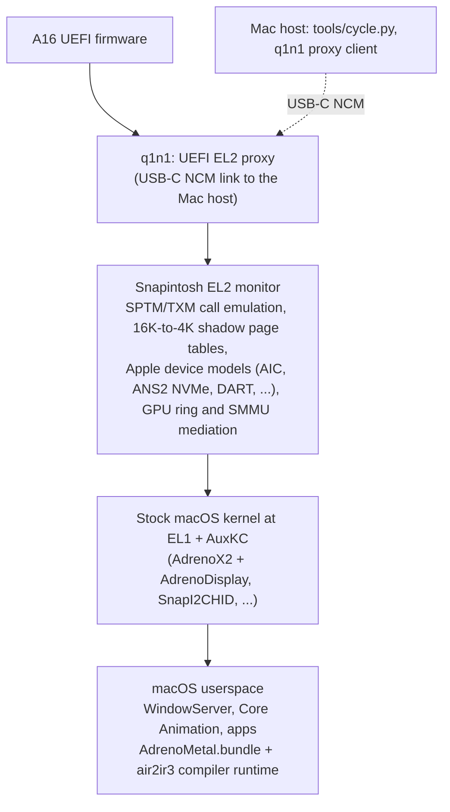

# Snapintosh


Snapintosh boots Apple's macOS 27 (build 26A428) on an ASUS Zenbook A16 laptop
with a Qualcomm Snapdragon X2 Elite (X2E-96-100). It is an EL2 monitor
(hypervisor) and the toolchain around it. The monitor runs Apple's stock
kernelcache (the J700/T8140 kernel) unmodified by default. It supplies the
platform contracts that the kernel expects from Apple silicon: the SPTM and TXM
monitor calls, translation of the kernel's 16 KiB page tables, and the Apple
devices the kernel looks for.

Graphics run on the laptop's own Adreno X2-90 GPU through a driver stack
written for this project:

- **AdrenoMetal.bundle**: a Metal driver plug-in.
- **AdrenoX2**: an IOGPU kernel extension, with **AdrenoDisplay** driving the
  internal panel.
- **air2ir3**: a shader compiler that translates Apple's AIR (Metal's IR) into
  Mesa's ir3 for the Adreno.

There is no software, CPU or paravirtual rendering path.

The project also includes an I2C-HID keyboard and touchpad driver (SnapI2CHID),
native QCC2072 Wi-Fi work, and NVMe storage through an emulated Apple storage
controller.

Snapintosh is used together with [q1n1](https://github.com/Snapintosh/q1n1), a
UEFI EL2 proxy forked from Asahi Linux's m1n1. q1n1 takes the machine at EL2
after UEFI and serves m1n1's proxy protocol over USB-C to a Mac host, which
drives Snapintosh from there.

## Status

This is experimental software, written for one laptop model.

| Area | State |
| --- | --- |
| macOS desktop on the A16 | Boots to the desktop with GPU acceleration. Rendering is correct: the pixel checks across the desktop test scenes pass. |
| Smoothness | In progress. Interaction is usable but not yet smooth. The target is a steady ~60 Hz first and the panel's 120 Hz later. |
| Input | The built-in keyboard and touchpad work, including trackpad gestures, Mission Control and app switching. |
| Wi-Fi (QCC2072) | Scanning, a WPA2 connection, DHCP and ping work through a host-proxy harness driven from the Mac. Joining from the macOS Wi-Fi menu does not work yet. |
| Storage | macOS is installed on, and boots from, the internal NVMe. |
| Other hardware | Audio, cameras, Bluetooth, sleep and external displays are not supported. |

[docs/STATUS.md](docs/STATUS.md) has the details, the known issues and the
roadmap.

## Required hardware

- An **ASUS Zenbook A16 with the Snapdragon X2 Elite X2E-96-100** (UX3607OA).
  Nothing else is supported. The monitor, device tables, clocks and register
  addresses are specific to this machine.
- A **Mac host** running macOS 27, connected to the A16 over USB-C. q1n1 brings
  up a USB NCM network link on that cable, and every boot, upload and log
  capture goes over it.
- AC power is strongly recommended. The tools refuse to boot or write the SSD
  below a battery threshold.

## Architecture in brief



```
A16 UEFI -> q1n1 (EL2 proxy) -> Snapintosh monitor (EL2) -> XNU + AuxKC (EL1) -> userspace + Metal plug-in (EL0)
```

[docs/ARCHITECTURE.md](docs/ARCHITECTURE.md) explains each layer.

## Repository layout

| Path | Contents |
| --- | --- |
| `compat/` | the EL2 monitor: SPTM/TXM contracts, CPU, interrupt, timer and device emulation, the GPU ring and SMMU mediation, the NVMe backend |
| `shadow/` | the page-table walker and the 16 KiB guest to 4 KiB hardware shadow tables |
| `probes/` | the code that runs on the target (loader, monitor entry) and the host-side image builder and runner |
| `tools/` | firmware acquisition, kernelcache analysis, the boot-cycle tool (`cycle.py`), build helpers and the native test suites |
| `gpu/adreno-kext/` | the AdrenoX2 kext (`kext/`, submodule [SnapAdreno](https://github.com/Snapintosh/SnapAdreno)), the AdrenoMetal plug-in (`plugin/`, submodule [SnapMetal](https://github.com/Snapintosh/SnapMetal)) and the shared register and contract headers (`include/`) |
| `gpu/air2ir3/` | the AIR to ir3 shader compiler (submodule [air2ir3](https://github.com/Snapintosh/air2ir3)) |
| `gpu/agx*` | an earlier virtual-AGX model, kept for reference |
| `drivers/` | SnapI2CHID (`snap-i2c-hid/`, submodule [SnapI2CHID](https://github.com/Snapintosh/SnapI2CHID)), the QCC2072 Wi-Fi controller (`snap-qcc2072/`, submodule [SnapQCC2072](https://github.com/Snapintosh/SnapQCC2072)), the boot framebuffer, a loader test |
| `config/` | monitor feature flags and guest launchd jobs |
| `build/` | generated output (gitignored, apart from the AuxKC link helpers) |
| `docs/` | design and reference documentation |

## Repositories

Snapintosh is split across the [Snapintosh organization](https://github.com/Snapintosh). This umbrella repository
holds the EL2 monitor, the host tools and the documentation, and mounts the components below as git submodules at
the paths they always had, so every relative build path is unchanged. Clone it with its submodules:

```sh
git clone --recurse-submodules https://github.com/Snapintosh/Snapintosh.git
git clone https://github.com/Snapintosh/q1n1.git     # next to it, at ../q1n1
```

| Repository | Mounted at | Contents |
| --- | --- | --- |
| [Snapintosh](https://github.com/Snapintosh/Snapintosh) | (this repository) | EL2 monitor (`probes/`, `compat/`, `shadow/`), `tools/`, docs |
| [q1n1](https://github.com/Snapintosh/q1n1) | `../q1n1` (separate checkout) | UEFI EL2 proxy and loader, a fork of Asahi Linux's m1n1 |
| [SnapAdreno](https://github.com/Snapintosh/SnapAdreno) | `gpu/adreno-kext/kext` | Adreno X2-90 IOGPU and display kernel driver |
| [SnapMetal](https://github.com/Snapintosh/SnapMetal) | `gpu/adreno-kext/plugin` | Metal driver plug-in (`AdrenoMetal.bundle`) |
| [air2ir3](https://github.com/Snapintosh/air2ir3) | `gpu/air2ir3` | AIR to Mesa ir3 shader compiler kit |
| [SnapI2CHID](https://github.com/Snapintosh/SnapI2CHID) | `drivers/snap-i2c-hid` | I2C-HID keyboard, touchpad and precision-touchpad driver |
| [SnapQCC2072](https://github.com/Snapintosh/SnapQCC2072) | `drivers/snap-qcc2072` | QCC2072 Wi-Fi driver (work in progress) |

A change to a component lands in its own repository first; the umbrella then moves the submodule pointer in a
separate commit.

## Building

You need:

- a Mac with Xcode (macOS 27 SDK);
- the Kernel Debug Kit for build 26A428, installed at
  `/Library/Developer/KDKs/KDK_27.0_26A428.kdk`;
- Python 3;
- Homebrew LLVM, Meson and Ninja for the shader compiler. Its Mesa checkout
  is fetched and patched by `gpu/air2ir3/tools/mesa-setup.sh`;
- a q1n1 checkout next to this one (`../q1n1`).

[docs/BUILDING.md](docs/BUILDING.md) has the steps.

## Host Testing & Verification

Snapintosh features a native host test suite runner that executes under Clang / GCC with AddressSanitizer and UndefinedBehaviorSanitizer enabled:

```sh
# Run the complete verified host suite (C test suites + Python unit tests)
python3 tools/test_runner.py

# Inspect workspace and hardware status with the interactive CLI dashboard
python3 tools/cycle.py dashboard
```

Detailed test receipts and architectural benchmark reports can be exported using `--json-report build/report.json`.

## Bring your own Apple software

This repository ships **no Apple, Qualcomm or ASUS binaries or firmware**. You
supply them yourself:

- **The macOS 27 restore image (IPSW).** Download it from Apple with
  `python3 tools/fetch-ipsw.py <url> [destination]`. Then extract the J700 boot
  set (kernelcache, device tree, SPTM, TXM and others) with
  `python3 tools/extract-firmware.py <ipsw> j700ap`. Nothing runs without it.
- **The Kernel Debug Kit** for 26A428, from Apple's developer downloads.
- **Device firmware.** The Adreno GPU's GMU and SQE microcode
  (`gen80100_gmu.bin`, `gen80100_sqe.fw`) and the QCC2072 Wi-Fi firmware come
  from the linux-firmware project. The Wi-Fi board file
  (`bdwlan_qcc2072_1p0_ncm820A.elf`) comes from ASUS's Windows WLAN driver
  package for this model. The tools check each file against a pinned SHA-256.

The project depends on Apple software that each user must obtain and use under
Apple's terms.

## Warning

Snapintosh is an experimental hypervisor that runs with full control of the
machine.

- **It writes the internal NVMe SSD.** Installing macOS changes the partition
  table, and the guest writes its own volumes. A bug can corrupt or destroy
  data on the SSD, including the Windows installation. Back up everything
  before you start, and keep a way to restore Windows.
- It programs clocks, voltages, the GPU and memory-bandwidth votes directly.
  The tools refuse to run on low battery and stop the run when the SoC gets
  too hot (`--thermal-guard`), but those guards are not a guarantee.
- It is not a supported or stable way to run macOS. Expect panics, hangs and
  cold reboots.

Use it at your own risk.

## Legal

Snapintosh is an independent project. It is not affiliated with, endorsed by
or sponsored by Apple, Qualcomm, ASUS or Asahi Linux. macOS, Metal and Apple
are trademarks of Apple Inc. Snapdragon and Adreno are trademarks of Qualcomm
Incorporated. Zenbook is a trademark of ASUSTeK Computer Inc. All other
trademarks belong to their owners.

Running macOS on non-Apple hardware may conflict with Apple's macOS software
licence agreement. You are responsible for making sure that your use complies
with the licences that apply to you.

## License

The project's own code is MIT licensed; see [LICENSE](LICENSE). Some
components carry other licences. Generated Mesa register tables keep Mesa's
MIT notice, and the QEMU tracer patch in `tools/qemu-sptm-oracle/` is
GPL-2.0-or-later. [THIRD_PARTY_NOTICES.md](THIRD_PARTY_NOTICES.md) and
[LICENSES/](LICENSES/) list every third-party component and its licence text.

## Credits

Snapintosh builds on the published work of others:

- **Asahi Linux and m1n1.** q1n1 is a fork of m1n1, and Snapintosh uses m1n1's
  proxy protocol, its Apple-silicon constants and its RTKit/mailbox knowledge.
- **Mesa and freedreno**, for the ir3 compiler that air2ir3 builds on, the
  Adreno register database and the a6xx/a8xx driver code used as reference.
- **The Linux msm/drm, clk/qcom, ath12k, i2c-hid and GENI driver authors.**
  Their drivers were read as hardware references. Snapintosh's drivers are
  written from the interface facts, and one generated table is derived from
  Linux's Adreno catalogue (see the notices).
- **jprx**, for [qemu-sptm](https://github.com/jprx/qemu-sptm) and
  [darwin-vm](https://github.com/jprx/darwin-vm), used to observe Apple's real
  SPTM/TXM as ground truth.
- **XNU** sources from Apple Open Source, for reading the kernel's side of each
  contract.

[THIRD_PARTY_NOTICES.md](THIRD_PARTY_NOTICES.md) has the complete list.

## Documentation

| Read | For |
| --- | --- |
| [docs/IMPROVEMENTS.md](docs/IMPROVEMENTS.md) | major refactoring, performance benchmarks, safety hardening & CI report |
| [docs/STATUS.md](docs/STATUS.md) | what works, known issues, roadmap |
| [docs/ARCHITECTURE.md](docs/ARCHITECTURE.md) | how the layers fit together, including the GPU stack and Wi-Fi |
| [docs/BUILDING.md](docs/BUILDING.md) | building the monitor, kexts, plug-in and compiler |
| [docs/RUNNING.md](docs/RUNNING.md) | a boot cycle with `tools/cycle.py` |
| [docs/KERNEL-PATCHES.md](docs/KERNEL-PATCHES.md) | the opt-in kernel patches and why each exists |
| [docs/BOOT-CHAIN.md](docs/BOOT-CHAIN.md) | how a stock macOS kernel boots on this SoC |
| [docs/FULL-INSTALL.md](docs/FULL-INSTALL.md) | installing to and booting from the internal NVMe |
| [docs/COMPATIBILITY.md](docs/COMPATIBILITY.md) | guest/host boundaries and pinned profiles |
| [gpu/air2ir3/README.md](gpu/air2ir3/README.md) | the shader compiler |
| [docs/WORKSPACE-LAYOUT.md](docs/WORKSPACE-LAYOUT.md) | local inputs, generated output and what is never committed |
| [docs/GUI-BOOT-ROADMAP.md](docs/GUI-BOOT-ROADMAP.md) | the path from the first kernel instruction to the desktop |
